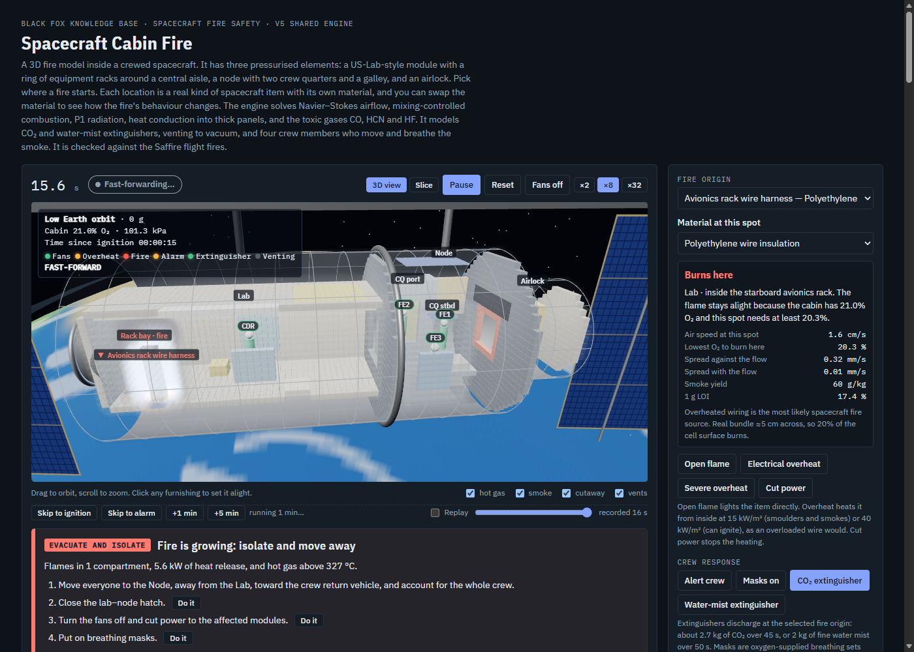
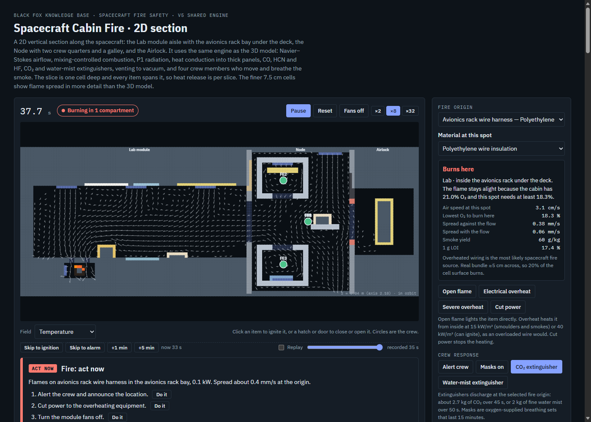
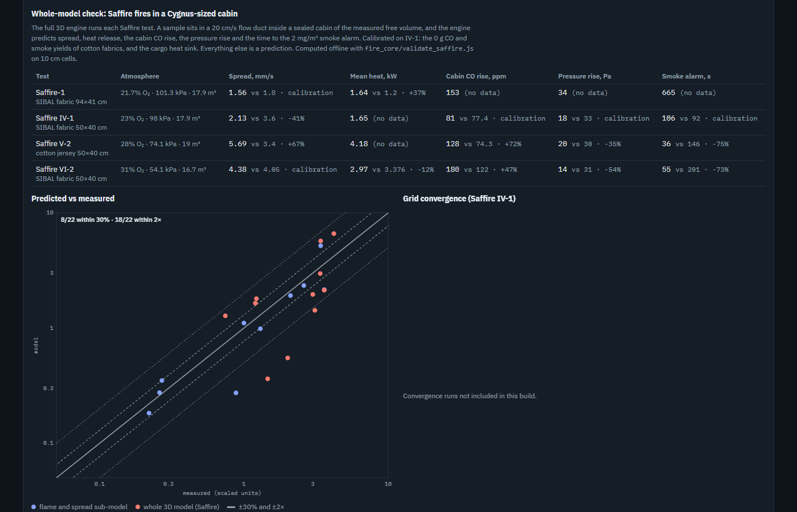
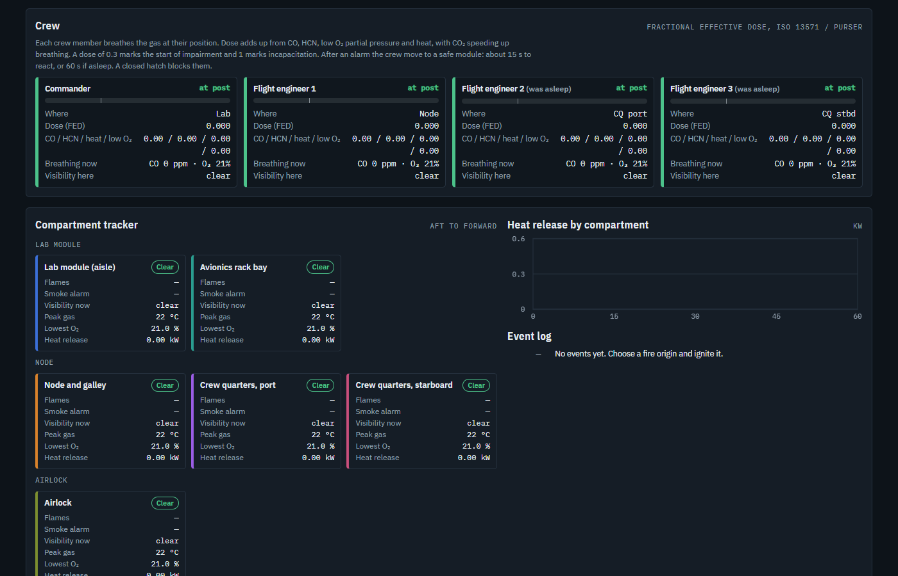

# Spacecraft Cabin Fire Simulator

A physics-based simulation of fire inside a crewed spacecraft. It covers ignition and spread, smoke and toxic gases, extinguishers, emergency venting and crew survival. It is calibrated and validated against NASA flight and ground fire experiments.

There are two versions, both running on the same engine:

| Version | File | Grid | Best for |
|---|---|---|---|
| **3D** | `fire_sim_ship/spacecraft_cabin_fire.html` | 15 cm cells, full vehicle | Realistic picture: smoke and flow in all directions, the vehicle in orbit or on a surface |
| **2D section** | `fire_sim_ship/spacecraft_cabin_fire_2d.html` | 7.5 cm cells, one vertical slice along the vehicle | Seeing exactly how flame and smoke move; faster and finer |

Both run in a web browser with no installation, on an ordinary CPU (no GPU needed).



*3D version: a severe electrical overheat in an avionics rack. Flames, hot gas, the CO₂ extinguisher cloud, crew positions and the live response guidance are all shown.*



*2D section: the Lab aisle with the burning rack bay under the deck, the Node with both crew quarters, and the Airlock. Arrows show the airflow and circles show the crew.*

---

## 1. Problem and motivation

Fire is one of the most dangerous emergencies on a spacecraft. The crew cannot leave quickly, and the cabin air is a small, closed volume. In microgravity a fire does not behave like it does on Earth:
- With no buoyancy, hot gas does not rise. A flame lives or dies on the airflow from the ventilation fans.
- Weak, near-limit flames produce far more carbon monoxide.
- Smoke goes wherever the fans carry it, not upward to a ceiling detector.
- Future exploration vehicles may use oxygen-enriched, low-pressure cabins (34% O₂ at 56.5 kPa), where more materials can burn.

Large fire tests in space are rare and expensive. NASA's Saffire experiments burned samples inside an empty Cygnus cargo vehicle. That makes validated computer models essential for vehicle design, material selection and crew training.

**Goal of this project:** build an interactive spacecraft fire model that:
1. solves the main physical processes in 3D;
2. uses real NASA data to set its constants;
3. is honestly validated against independent measurements;
4. helps a user understand what the right crew response is in each scenario.

---

## 2. What the simulator does

| Area | Capability |
|---|---|
| **Vehicle** | A US-Lab-style module with a rack ring and central aisle, a Node with two crew quarters and a galley, and an Airlock. It has hatches and doors, ventilation diffusers, return grilles and vent valves. |
| **Fire origins** | 14 real kinds of items, such as rack wiring, cable trays, panels, stowage bags, laptop foam, sleeping bags, clothing, Velcro and hatch seals. Each has a choice of 12 spacecraft materials (polyethylene, PTFE/Teflon, Kapton, silicone, polycarbonate, PMMA, polyurethane foam, nylon, Nomex, cotton, paper and SIBAL fabric). |
| **Ignition** | Open flame, electrical overheat (15 kW/m²: smoulders) or severe overheat (40 kW/m²: can ignite). |
| **Atmospheres** | ISS (21% O₂, 101 kPa), exploration (34%, 56.5 kPa), Mars transit, lunar lander, Mars surface, fans off, or any gravity, O₂ and pressure you choose. |
| **Physics** | 3D airflow, combustion, radiation, heat conduction into thick panels, flame spread, smoke and visibility, CO, HCN and HF, and sealed-compartment pressure. |
| **Response** | Cut power, fans off, close hatches, alert the crew, oxygen masks, a CO₂ extinguisher, a fine-water-mist extinguisher, and venting a module to vacuum. |
| **Crew** | 4 astronauts. They react to the alarm (later if asleep), move to a safe module and accumulate a toxic and thermal dose (FED). A closed hatch can trap them. |
| **Guidance** | Advice under the 3D view changes with the situation (prevention, act now, evacuate and isolate, all clear), and its "Do it" buttons act on the simulation. |
| **Tools** | Fast-forward to ignition or alarm, replay, comparing two runs, CSV export, saving and loading scenarios, and a training quiz. |
| **Validation** | Sub-model checks and whole-model Saffire runs are shown in the page, with a predicted-vs-measured chart and a grid-convergence study. |

---

## 3. Physical model

The cabin is divided into cubic cells, 15 cm by default, about 71,000 cells in total. Each time step (about 0.1–0.25 s) the engine solves the following.

### 3.1 Gas flow

**Momentum** (variable-density Navier–Stokes with buoyancy):

$$
\frac{\partial \mathbf{u}}{\partial t} + (\mathbf{u}\cdot\nabla)\mathbf{u} = -\nabla \tilde{p} + g\left(\frac{T}{T_0} - 1\right)\hat{\mathbf{j}} + \nabla\cdot\big[(\nu + \nu_t)\nabla\mathbf{u}\big]
$$

The turbulent viscosity comes from the Smagorinsky model:

$$
\nu_t = (C_s \Delta)^2 \, |S|, \qquad C_s = 0.18
$$

Here $\Delta$ is the cell size and $|S|$ is the strain rate. Advection is semi-Lagrangian.

**Pressure projection** (red-black SOR). Hot gas expands, so the velocity field is not divergence-free:

$$
\nabla\cdot\mathbf{u} = \frac{\dot{q}'''_{\text{net}}}{\rho\, c_p\, T} + \text{(mass sources from extinguishers and venting)}
$$

**Sealed compartments** carry a background pressure, so closing a hatch traps smoke and pressure:

$$
\frac{dP}{dt} = (\gamma - 1)\,\frac{\dot{Q}}{V}
$$

**Ventilation** recirculates, as on the ISS. Return air passes a particulate (HEPA) filter and is blown back in, so CO, HCN and the O₂ deficit stay in the cabin.

### 3.2 Combustion

Mixing-controlled heat release per unit volume:

$$
\dot{q}''' = \rho\, \Delta H_{O_2}\, \frac{\min(Y_F,\; Y_{O_2})}{\tau_{\text{mix}}}, \qquad \Delta H_{O_2} = 13.1\ \text{MJ/kg}
$$

- An FDS-style extinction check is applied: a mixture burns only if it can reach the critical flame temperature, 1600 K.
- CO₂ agent raises the mixture heat capacity, which acts like a lower oxygen level ($x_{CO_2}$ is the CO₂ mole fraction):

$$
X_{\text{eff}} = \frac{X}{1 + 0.6\, x_{CO_2}}
$$

### 3.3 Radiation (P1 approximation)

The incident radiation $G$ satisfies:

$$
-\nabla\cdot\left(\frac{1}{3\kappa}\nabla G\right) + \kappa G = E,
\qquad
E = \begin{cases} \chi_r\, \dot{q}''' & \text{inside flames} \\ 4\kappa\sigma T^4 & \text{elsewhere} \end{cases}
$$

with absorption from soot plus combustion gases:

$$
\kappa = 0.03 + 1862\, f_v\, T + \kappa_{\text{gas}}
$$

Here $f_v$ is the soot volume fraction and $\chi_r = 0.3$ is the radiated fraction. Walls use Marshak boundary conditions. Flames and smoke preheat distant items, and the walls absorb radiation.

### 3.4 Solids and flame spread

- **Thin items** (fabric, paper, wire insulation) are treated as lumped.
- **Thick panels** (PMMA, polycarbonate, silicone) use implicit 1D conduction with 8 nodes:

$$
\rho c\, \frac{\partial T}{\partial t} = k\, \frac{\partial^2 T}{\partial x^2}
$$

**Flame existence.** The flame temperature depends on oxygen $X$, flow speed $U$ and pressure $P$:

$$
T_f = T_g + \kappa_f X \left[1 - \frac{R\,(101.3/P)}{U + U_d}\right]
$$

A flame exists if $T_f \ge T_c$ and $U \le U_{bo}$, the blow-off limit. This captures quenching in still air, blow-off in strong flow, and the effects of oxygen and pressure.

**Opposed-flow spread** (de Ris thin-fuel theory, with $\lambda$ at the flame film temperature):

$$
V_{\text{opp}} = \frac{\pi}{4}\, \frac{\lambda\,(T_f - T_v)}{m''\, c_s\,(T_v - T_g)}
$$

**Concurrent spread** ($\varphi$ is the normalised flame-temperature factor):

$$
V_{\text{thin}} \propto U\, \varphi^{\,n},
\qquad
V_{\text{thick}} = k_t\, \frac{U\, \dot{q}''^{\,2}}{k\rho c\, (T_v - T_\infty)^2}
$$

**Burning rate**, from a surface heat balance divided by the heat of gasification $L_g$:

$$
\dot{m}'' = \frac{\dot{q}''_{\text{flame}} + \dot{q}''_{\text{rad}} + \dot{q}''_{\text{overheat}} - \dot{q}''_{\text{mist}} - \dot{q}''_{\text{cond}}}{L_g}
$$

### 3.5 Products, suppression and crew

**Yields:** CO, HCN, HF and soot. The 0 g CO and smoke yields come from Saffire. The CO yield is interpolated with gravity:

$$
y_{CO}(g) = y_{0g} + \left(y_{1g} - y_{0g}\right)\sqrt{g/g_0}
$$

It also rises toward 0.2 kg/kg when the compartment runs short of O₂. Soot yield scales with pressure.

**Suppression and venting:**
- **CO₂ extinguisher:** about 2.7 kg over 45 s. It dilutes O₂, cools the gas and adds mass.
- **Water mist:** about 2 kg over 50 s. It evaporates on the available heat, dilutes O₂ and wets surfaces.
- **Venting to vacuum:** choked outflow through a valve of area $A$, which also drives a stirring flow toward the valve:

$$
\frac{dP}{dt} = -\,\frac{C_d\, A\, c^{*}}{V}\, P
$$

**Crew dose** (ISO 13571 / Purser fractional effective dose). Times are in minutes and concentrations in ppm:

$$
\text{FED} = \sum \left[ 2.76\times10^{-5}\, C_{CO}^{\,1.036} + \left(\frac{e^{\,C_{HCN}/43}}{220} - 0.0045\right) \right] v_{CO_2}\, \Delta t
\;+\; \sum \frac{\Delta t}{e^{\,8.13 - 0.54\,(20.9 - X_{O_2})}}
\;+\; \sum \frac{\Delta t}{5\times10^{7}\; T^{-3.4}}
$$

- The three terms are toxic gases (with $v_{CO_2}$, the extra breathing caused by CO₂), low oxygen, and heat ($T$ in °C).
- A FED of 0.3 means impairment and 1 means incapacitation.
- Concentrations are converted to sea-level-equivalent partial pressure, so a vented module is lethal through hypoxia.

---

## 4. Data and calibration

All constants come from the Black Fox knowledge base (NASA NTRS, Europe PMC and TechPort records). Only the items below were **fitted**; everything else is a **prediction**.

| Constant | Calibrated on |
|---|---|
| Thin concurrent spread coefficient | Saffire-1: SIBAL, 0 g, 21.7% O₂, 20 cm/s → 1.8 mm/s |
| Oxygen exponent n of thin spread | Saffire VI-2: 31% O₂, 54.1 kPa → 4.05 mm/s |
| Thick concurrent spread coefficient | Saffire VI-3: 10 mm PMMA → 0.38 mm/s |
| SIBAL flame-temperature parameters | BASS-II quench speeds (1 cm/s at 21% O₂, 5 cm/s at 16%) |
| PMMA limits | ISS PMMA tests (pmc-5760683) |
| Kapton, silicone and nylon 1 g upward limits | NASA-STD-6001 Test 1 MOCs (NTRS 20110008636) |
| 0 g CO and smoke yields of cotton fabrics, cargo heat sink | Saffire IV-1 CO rise, alarm time and pressure rise |

---

## 5. Validation results



### 5.1 Whole 3D model against the Saffire flight fires (10 cm cells)

The full engine reproduces each Saffire test: the sample sits in a 20 cm/s flow duct inside a sealed cabin of the measured free volume.

| Test | Atmosphere | Spread (mm/s), model / measured | Mean heat (kW), model / measured | Cabin CO (ppm), model / measured | Pressure rise (Pa), model / measured | Smoke alarm (s), model / measured |
|---|---|---|---|---|---|---|
| Saffire-1 (SIBAL) | 21.7%, 101 kPa | 1.56 / 1.8 (cal.) | 1.64 / 1.2 ± 0.3 | 153 / — | 34 / — | 665 / — |
| Saffire IV-1 (SIBAL) | 23%, 98 kPa | 2.13 / 3.6 (−41%) | 1.65 / — | 81 / 77 (cal.) | 18 / 33 (cal.) | 106 / 92 (cal.) |
| Saffire V-2 (cotton) | 28%, 74 kPa | 5.69 / 3.4 (+67%) | 4.18 / — | 128 / 74 (+72%) | 20 / 30 (−35%) | 36 / 146 (−75%) |
| Saffire VI-2 (SIBAL) | 31%, 54 kPa | 4.38 / 4.05 (cal.) | 2.97 / 3.38 (−12%) | 180 / 122 (+47%) | 14 / 31 (−54%) | 55 / 201 (−73%) |

### 5.2 Sub-model checks (examples)

| Check | Measured | Model |
|---|---|---|
| Saffire-2 concurrent spread, 5 cm strip, 20 / 25 cm/s | 2.1 / 2.6 mm/s | 1.91 / 2.34 mm/s |
| Saffire-1 opposed spread | 1.3 mm/s | 0.99 mm/s |
| LUCI downward spread at lunar gravity | 0.92–1.1 mm/s | 1.10 mm/s |
| Saffire IV-2 / V-3 / VI-4 thick PMMA growth | 0.22 / 0.26 / 0.27 mm/s | 0.18 / 0.28 / 0.35 mm/s |
| PMMA upward limit, NASA-STD-6001 Test 1 | 18–19% O₂ | 16.8% O₂ |

**Summary:** of 22 independent checks, **18 are within a factor of 2** and **8 are within 30%**.

### 5.3 Grid convergence (Saffire IV-1)

| Cell size | 15 cm | 10 cm | 7.5 cm | 5 cm |
|---|---|---|---|---|
| Spread, mm/s | 2.32 | 2.13 | 2.00 | 1.71 |
| Mean heat release, kW | 1.90 | 1.65 | 1.46 | 1.38 |
| Cabin CO, ppm | 58 | 81 | 59 | 80 |

- **Heat release** is close to converged.
- **Spread** still falls as cells shrink, so the 15 cm grid used in the live page probably overstates spread by about 25%.
- **CO** varies without a trend.
- **Pressure rise and alarm time** are read at a single sensor point, so they are sensitive to the grid.

### 5.4 Model defects found and fixed during validation
- A two-sided item released twice its fuel mass. Fixed by distributing the burning per face, which conserves mass.
- In 0 g, fire could never ignite a neighbouring cell, because the ignition check assumed zero flow.
- An electrical overheat was added once for each exposed face. It now enters once per item.
- Fuel vapour built up and then flashed in bursts of up to 187 kW. Fixed by making an oxygen-starved flame stand off the surface.
- Smoke detectors missed smoke in 0 g. Detectors now also sit at the ventilation returns, as on the ISS.
- Concurrent spread did not depend on oxygen because of a cap. It now follows φⁿ, fitted to flight data.

---

## 6. Example findings from the simulator
- **Severe wire overheat in a rack (ISS air):** it ignites in about 8 s. CO reaches over 1,400 ppm in the rack bay; the 1-hour spacecraft limit is 425 ppm. A CO₂ discharge puts the fire out within about 25 s.
- **Sleeping bag in the exploration atmosphere (34% O₂):** a slow, small fire. CO and HCN build up in the crew quarters before smoke reaches the detector threshold, which is a case for CO sensors.
- **Venting the Lab module:** the flame goes out from low pressure. But a crew member left inside when the hatch was closed is incapacitated by hypoxia. The rule is: close the hatch only after everyone is out.
- **Water mist vs CO₂:** both put out small fires. Mist leaves the air breathable; CO₂ requires oxygen masks (NTRS 20110012896).



---

## 7. How to run

1. Open `fire_sim_ship/spacecraft_cabin_fire.html` (3D) or `fire_sim_ship/spacecraft_cabin_fire_2d.html` (2D section) in Chrome, Edge or Firefox. No server or installation is needed.
2. Choose a fire origin and a material, then click **Open flame**, **Electrical overheat** or **Severe overheat**.
3. Use **Skip to ignition**, the crew-response buttons and the guidance panel.

**Command line** (requires Node.js 18 or later):
```bash
cd fire_core
node test_ship.js 0.15 240 L1 severe iss '[{"t":30,"do":"power"},{"t":40,"do":"co2"}]'   # scripted 3D scenario
LAYOUT=ship2d node test_ship.js 0.075 240 L1 severe iss                                 # the same in 2D
node validate_saffire.js 0.1 1          # Saffire whole-model validation + grid convergence
cd ../fire_sim_ship/src && python build.py   # rebuild both pages (3D and 2D)
```

To run the automated browser self-test, open the page with `#autotest` at the end of the address. It ignites, extinguishes and then reports PASS or FAIL in the page title.

---

## 8. Repository structure
```
fire_core/            shared fire engine (pure JavaScript, runs in a browser worker or in Node)
  engine.js           physics: flow, combustion, radiation, solids, species, suppression, crew
  layouts.js          geometries: 'ship' (3D spacecraft), 'ship2d' (2D section), 'saffire' (validation cabin)
  validate_saffire.js whole-model validation and grid convergence → validation_results.json
  test_ship.js        scenario runner (LAYOUT=ship2d for the 2D section)
fire_sim_ship/
  spacecraft_cabin_fire.html      3D simulator (open in a browser)
  spacecraft_cabin_fire_2d.html   2D section simulator (open in a browser)
  src/                page sources: ship_body.html (one page, 3D and 2D modes), worker_v5.js, base_style.html, build.py
docs/images/          screenshots used in this report
```

---

## 9. Limitations (stated openly)
- **Resolution:** with 15 cm cells, flames are modelled below the grid scale and a burning item is at least one cell. The spread rate is not fully grid-converged.
- **Toxic gases:** they come from fixed yields, not detailed chemistry. Only cotton fabrics have measured 0 g yields; the other materials use about 6× their 1 g CO yield.
- **Material data:** apart from SIBAL, PMMA, Kapton, silicone and nylon, flammability limits come from handbook LOI values.
- **Hardware:** extinguisher amounts and vent-valve size are representative, not hardware specifications.
- **Smoke alarm:** at reduced pressure the smoke alarm comes 2–4× too early compared with Saffire.
- **Crew:** behaviour is a simple rule (react, then move away). Real crews follow procedures and fight the fire.
- **Geometry:** the vehicle layout is representative, not a specific spacecraft.
- **Not an operational tool:** this is for teaching and research, not an operational procedure.

---

## 10. Defence preparation

### Key messages (1-minute summary)
1. Fire in microgravity is governed by the ventilation flow, not by buoyancy. The model shows this directly: the same material can burn or go out depending on the fan airflow, the oxygen level and the pressure.
2. The model is physics-based: 3D flow, combustion, radiation, conduction and toxic species. It is calibrated on a small, declared set of NASA measurements.
3. It is validated honestly: 18 of 22 independent checks are within 2×, and the remaining errors are published.
4. It is useful for response training. It shows why cutting power, using water mist and closing hatches only after the crew is out matter, and why venting is a dangerous last resort.

### Likely questions and answers

**Q: Why not use FDS (Fire Dynamics Simulator)?**
FDS is the reference code and our combustion and extinction approach follows it. But FDS needs hours on a workstation and has no interactive response or crew model. This engine runs in a browser at about 8× real time on a laptop CPU, so a user can explore scenarios live. The cost is resolution, and the convergence study quantifies that cost.

**Q: How do you know the results are right?**
We separated calibration data from validation data. The model reproduces flight measurements it was not fitted to (Saffire-2, Saffire V-2 and VI-2, LUCI and thick PMMA), mostly within a factor of 2. The validation table in the page marks every row as calibration, independent or qualitative.

**Q: Where is the model weakest?**
The spread rate for one Saffire test (−41%), cotton (+67%), smoke-alarm timing at low pressure (2–4× too early) and grid sensitivity of the spread rate. These are listed in the page and in this report.

**Q: Why is CO so important?**
Flames in 0 g are weak and near their limits, so they produce far more CO. Saffire cotton fabrics gave about 0.034 kg/kg, against about 0.004 on Earth. In our simulations, CO can reach dangerous levels before smoke triggers a detector.

**Q: Is depressurisation a good way to fight a fire?**
The model reproduces what NASA testing found (NTRS 20260003546). Venting is slow, the outflow can fan the fire first, and anyone left in the module dies of hypoxia. It is a last resort, used only after the crew is out and the module is sealed.

**Q: CO₂ or water mist?**
Both put out small fires in the model. CO₂ makes the air unbreathable without oxygen masks; water mist does not. This is why NASA developed the fine-water-mist extinguisher for the ISS (NTRS 20130011664, 20110012896).

**Q: What is the grid convergence result?**
Heat release changes by about 5% between 7.5 and 5 cm cells, which is close to converged. Spread is not yet converged (−15% over the same step), so the live 15 cm grid overstates spread somewhat.

**Q: What would you do next?**
- Add measured 0 g yields for plastics.
- Model the extinguisher jet in detail.
- Use finer local grids near the fire.
- Compare against Saffire PMMA tests in 3D.

### Suggested demo for the defence (3–4 minutes)
1. **ISS cabin:** select the rack wire harness and click **Severe overheat**, then **Skip to ignition**. Show the flames, the smoke following the ventilation, and the guidance switching to "Act now".
2. Click **CO₂ extinguisher** and show the fire going out and the crew dose staying low.
3. **Exploration atmosphere:** change the material to show how much more burns at 34% O₂ (the "Materials on board" table).
4. Show the venting trap: close the Lab–Node hatch early, then vent the Lab, and the commander is incapacitated.
5. Scroll to **Validation**: show the Saffire table, the predicted-vs-measured chart and the convergence chart.

---

## 11. Main sources (NASA NTRS unless noted)
- 20170008805: Results of Large-Scale Spacecraft Flammability Tests (Saffire-1, Saffire-2)
- 20260001992: Heat and Smoke Emission from Tests on the Saffire VI Experiment (Table 1, Saffire IV–VI)
- 20150008962: BASS / BASS-II flame growth and quenching over SIBAL
- 20110008636: Selected Parametric Effects on Materials Flammability Limits (NASA-STD-6001 Test 1)
- 20260003546: Risks of Depress as a Fire Suppression Technique in Spacecraft
- 20130011664, 20110012896: ISS Fine Water Mist Portable Fire Extinguisher
- 20050215297: CO₂ dispersion in the Combustion Integrated Rack (CO₂ extinguisher requirement)
- 20140000850: Chemical Pollution from Combustion of Modern Spacecraft Materials
- 20080034883: Microgravity Flame Spread in Exploration Atmospheres
- 20250010653: LUCI Lunar Combustion Investigation
- Europe PMC 29317681 (pmc-5760683): ISS PMMA flammability
- McGrattan et al.: FDS combustion and extinction modelling
- ISO 13571 / Purser: fractional effective dose for toxic gases and heat
